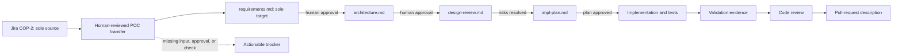

# COP-2 Architecture

## Decision Summary

Use the repository's existing artifact-driven SDLC orchestration model for the POC scoped by [COP-3](https://shalini-srinivasan.atlassian.net/browse/COP-3). The sole source is Jira issue COP-2; the sole target is this repository's `requirements.md`. The transfer is one-way and human-reviewed. Jira is authoritative for story facts; approved repository decisions and approval evidence are not silently overwritten.

This is a bounded proof of concept, not a production or scheduled synchronization service. An unchanged rerun must preserve stable requirement IDs and avoid duplicate content. Source changes or conflicts must be surfaced for human review before updating an approved target.

## Traceability

| Source | Architecture response |
| --- | --- |
| COP-2 / FR-1 | `requirements.md` is the authoritative requirements and acceptance-criteria record. |
| COP-2 / FR-2 | This architecture and the subsequent `design-review.md` record approach, dependencies, risks, validation, and traceability. |
| COP-2 / FR-3 | Approval records gate every transition to dependent work. |
| COP-2 / FR-4 | `impl-plan.md` will contain dependency-ordered tasks only after architecture and design approval. |
| COP-2 / FR-5 to FR-7 | Implementation, validation, review, and pull-request evidence are produced in later phases. |
| COP-2 / FR-8 | A blocker record stops progression whenever an input, integration, approval, or check is unavailable. |
| COP-3 / POC-1 to POC-6 | Validate the single Jira-to-`requirements.md` transfer, metadata, missing-input handling, rerun behavior, conflict review, and evidence. |

## Components And Responsibilities

| Component | Responsibility | Inputs | Outputs |
| --- | --- | --- |
| Jira issue COP-2 | Sole authoritative source for story facts in this POC. | Summary, description, scope, out-of-scope statements, acceptance criteria. | Retrieved issue evidence. |
| SDLC orchestrator | Enforces phase order and gates. | Jira context, artifacts, approvals, validation results. | Active-phase state, blocker messages, handoffs. |
| Planner | Produces requirements, architecture, and implementation planning artifacts. | Approved work-item context and prior artifacts. | `requirements.md`, `architecture.md`, `impl-plan.md`. |
| Design reviewer | Assesses architecture risks, gaps, controls, and remediation. | Architecture proposal. | `design-review.md` and required architecture updates. |
| Implementation and test agents | Implement only approved tasks and produce focused verification. | Approved plan and architecture/design evidence. | Changed files, tests, validation evidence. |
| Code reviewer and PR-description agent | Assess readiness and prepare evidence for human review. | Completed changes and validation results. | Findings, dispositions, pull-request description. |
| Repository `requirements.md` | Sole POC target and durable evidence store. | COP-2 story facts and human-approved decisions. | Requirement IDs, acceptance mapping, approvals, validation evidence. |

## Data Flow

## Control Flow And Gates

1. Retrieve COP-2 and use its description and acceptance criteria as work-item context.
2. Transfer only COP-2 story facts into `requirements.md`; validate fields and traceability.
3. Obtain human approval before architecture and design review; retain approved decisions in the artifact.
4. On unchanged reruns, preserve stable requirement IDs and avoid duplicate content; on source changes, surface a diff for human review.
5. Block and report missing source fields, unavailable Jira access, invalid metadata, or validation failures.
6. Implement and verify only the COP-3 POC tasks; diagnose and rerun failed checks.
7. Conduct code review and prepare pull-request evidence only after satisfactory validation.
8. Require human pull-request approval before merge; no production deployment or scheduled synchronization is included.

## Validation Strategy

| Layer | Evidence |
| --- | --- |
| Metadata | Each Markdown artifact has all required YAML front-matter fields and a valid lifecycle status. |
| Traceability | Each phase artifact links its content to COP-2 and applicable requirement identifiers. |
| Gate enforcement | Approval records and blocker states prevent progression to dependent phases. |
| POC source/target | Evidence and checks are limited to Jira COP-2 and `requirements.md`. |
| Rerun/conflict behavior | Compare source facts with the approved target; do not duplicate or silently overwrite approved content. |
| Implementation | Focused tests, linting, security scanning, and any documented repository checks run without bypass. |
| Review readiness | Code-review findings and their dispositions, known limitations, and validation results are captured before PR preparation. |

## Dependencies

- An authenticated Jira issue-read integration for authoritative story retrieval.
- Repository write access for evidence artifacts.
- Human reviewers to approve requirements, architecture/design, and pull requests.
- COP-3 defines the single-source/single-target POC scope.

## Risks And Mitigations

| ID | Risk | Mitigation |
| --- | --- | --- |
| R-1 | Approval evidence is absent or ambiguous. | Record the approver, date, and artifact in each approval table; block the next phase. |
| R-2 | A one-issue POC could be mistaken for production synchronization. | Keep the COP-3 boundary explicit; exclude scheduling, additional sources/targets, merge, and deployment. |
| R-3 | Artifacts become inconsistent or lack required metadata. | Validate front matter and traceability after each artifact update. |
| R-4 | A validation or security check fails. | Diagnose, repair, and rerun; never bypass the failed gate. |
| R-5 | Sensitive issue or repository data enters evidence artifacts. | Limit records to necessary work-item metadata and exclude secrets, tokens, and credentials. |

## Current Blockers

| ID | Blocker | Impact | Resolution |
| --- | --- | --- |
| None | The POC scope gap is resolved by COP-3: source COP-2, target `requirements.md`. | Implementation planning may proceed within COP-3 only. | Keep all work within COP-3 acceptance criteria. |

## Approval Record

| Gate | Status | Evidence |
| --- | --- | --- |
| Requirements approval | Approved | User approved `requirements.md` in Copilot Chat on 2026-10-29. |
| Architecture approval | Approved | User approved in Copilot Chat on 2026-10-30. |
| Design review | Approved for COP-3 POC | User authorized the bounded POC and proceeding on 2026-10-30; see `design-review.md`. |
| Implementation authorization | Approved for COP-3 POC only | User directed proceeding; no production automation or deployment. |

## Next Step

Create and execute the COP-3 implementation plan. Any expansion beyond one Jira source and one Markdown target requires new requirements and approval.