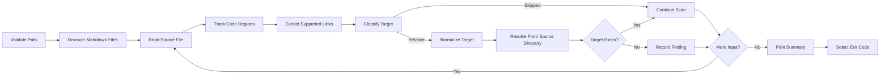

# COP-5 Architecture

## Work Item And Phase

- Jira issue: [COP-5](https://shalini-srinivasan.atlassian.net/browse/COP-5)
- Requirements source: [requirements.md](requirements.md) (approved 2026-11-02)
- Active phase: Implementation planning
- Architecture status: Approved by the user on 2026-11-02
- Target artifact: `COP-5/scripts/check-markdown-links.ps1`

This document does not authorize implementation.

## Objective And Scope

A deterministic, read-only PowerShell command that recursively examines Markdown files beneath a supplied folder and reports relative file or directory links whose targets do not exist.

The command will:

- Accept a required `-Path` folder parameter.
- Recursively discover `*.md` files, excluding `.git` and `node_modules`.
- Check inline links, images, and reference-style link definitions.
- Ignore links inside fenced code blocks and inline code spans.
- Resolve relative targets from the source Markdown file's directory and check existence only.
- Make no network access and modify no files.
- Return exit code `0`, `1`, or `2`.

External URL validation, anchor validation, automatic repair, CI integration, and scheduled execution are out of scope.

## Repository Assessment

The repository contains PowerShell validation scripts: `COP-2/scripts/validate-cop3-poc.ps1` and `COP-4/scripts/validate-login-page.ps1`. COP-5 follows their per-work-item `scripts/` placement. Markdown discovery, parsing, normalization, and link resolution are owned by the new script, using only built-in PowerShell and .NET APIs (no package installation).

## Architecture Overview

A single command-line pipeline with locally scoped helper functions:

Processing is local and sequential, favouring predictable line reporting and clear error attribution over parallelism.

## Component Responsibilities

| Component | Responsibility | Requirement trace |
| --- | --- | --- |
| Parameter validator | Confirm `-Path` is present, exists, and is a directory; emit an actionable error otherwise. | NFR-1 |
| Markdown file discovery | Recursively enumerate `*.md` files while pruning `.git` and `node_modules`. | FR-1, NFR-2 |
| Source reader | Read each file with line awareness and surface access or decoding failures. | FR-3, NFR-3 |
| Code-region filter | Exclude fenced code blocks and inline code spans from link extraction. | Approved decision 3 |
| Link extractor | Identify inline links, images, and reference-style definitions with source line and text or label. | FR-1, FR-3 |
| Target classifier | Skip in-page anchors, scheme-based targets, and root-relative or absolute paths. | FR-4 |
| Target normalizer | Remove angle brackets and titles, strip query and fragment, percent-decode the path. | NFR-6, approved decisions 4, 7 |
| Path resolver | Resolve each eligible target against the source file's directory. | NFR-6 |
| Existence checker | Test whether the resolved file or directory exists without opening it. | FR-2, NFR-4, NFR-6 |
| Finding reporter | Emit source file, line, link text, original target, and unresolved path. | FR-3, NFR-5 |
| Summary and exit controller | Print the broken-link count and return `0`, `1`, or `2`. | FR-5, NFR-1, NFR-2, NFR-3 |

## Data Flow

1. PowerShell binds the caller-provided `-Path`.
2. The validator resolves the scan root and confirms it is an accessible directory.
3. Discovery obtains Markdown files, excluding `.git` and `node_modules`.
4. If no Markdown files are found, print an explicit message and exit `0`.
5. Each file is read with line boundaries preserved.
6. A state machine tracks fenced code blocks (backtick and tilde); inline code spans are masked before extraction.
7. The extractor produces candidates: source file, line, link text or reference label, original target.
8. The classifier skips empty targets, targets beginning with `#`, any target with a URI scheme (`http:`, `https:`, `mailto:`, `tel:`, `data:`, others), root-relative targets, and absolute Windows, UNC, or platform paths.
9. The normalizer removes wrappers and titles, separates query and fragment, and percent-decodes the path.
10. The resolver combines the target with the source directory and canonicalizes it.
11. Existing files and directories produce no finding.
12. Missing targets produce one finding: `file:line: [text](target) -> unresolved path`.
13. After all files are processed, print a summary count.
14. Exit codes: `0` no broken targets (including no Markdown files); `1` broken targets found; `2` invalid input or an operational scan error.

## Security And Privacy

- **Path traversal:** links may contain `..`; they are canonicalized from the source directory and checked for existence only. Targets are never executed, imported, or read. Whether targets outside the scan root are checked is decision ADR-11 below.
- **Regex denial of service and large files:** line-oriented processing with simple expressions and explicit code-region state; no nested unbounded patterns over whole files. Resource and decoding failures become actionable operational errors, never silent success.
- **Network isolation:** no HTTP requests or external link-checking tools; any target with a URI scheme is excluded before path resolution.
- **Output privacy:** output is limited to source location, link text, target as written, unresolved path, and counts. No file contents, environment variables, or credentials. Source paths are shown relative to the scan root where practical.
- **Read-only:** enumeration, reads, and existence checks only; no create, update, delete, rename, or repair.

## Error And State Handling

| Condition | Behavior | Exit code |
| --- | --- | ---: |
| `-Path` missing | Print parameter guidance. | 2 |
| Path does not exist | Print actionable message with the supplied path. | 2 |
| Path is not a directory | State that `-Path` must identify a directory. | 2 |
| Root cannot be enumerated | Report the inaccessible directory. | 2 |
| No Markdown files found | Print explicit no-files message and zero summary. | 0 |
| Markdown file cannot be read | Report the file and failure; never treat as valid. | 2 |
| Relative target exists | Omit from findings. | Unchanged |
| Relative target missing | Emit one finding; increment count. | 1 |
| Link in fenced or inline code | Skip. | Unchanged |
| Anchor, scheme URL, root-relative, or absolute target | Skip without validation. | Unchanged |
| Percent-decoding or normalization fails | Report source location and malformed target. | 2 |
| Unexpected exception | Concise actionable error without source contents. | 2 |

Operational errors take precedence: if a scan is incomplete, the final exit code is `2` even when broken links were also found.

## Dependencies And Constraints

- PowerShell and standard .NET filesystem and URI APIs only.
- Supported PowerShell editions (Windows PowerShell 5.1 and/or PowerShell 7+) to be confirmed in design review.
- Case sensitivity follows the host filesystem.
- Existence-only validation; directories are valid targets; query and fragment are ignored.
- Parsing covers the approved link forms only; full CommonMark parsing is not required.
- Reference-style definitions are checked at their definition lines; reference uses need not be resolved.
- No CI workflow, scheduled task, auto-fix, or external service.

## Risks And Review Questions

| Risk or question | Response or decision needed |
| --- | --- |
| Nested parentheses, escapes, and titles in Markdown destinations. | Bounded parsing steps and fixture-driven validation; confirm syntax boundary in design review. |
| Variable fence lengths and characters. | Track backtick and tilde fences; close only with a compatible fence. |
| Inline code with multiple backtick delimiters. | Mask code spans before extraction; test single and repeated delimiters. |
| URI schemes beyond named examples. | Skip any syntactically valid scheme prefix. |
| Windows drive paths resemble URI schemes. | Classify drive-absolute paths before scheme detection and skip them. |
| Decoded targets may contain separators or `..`. | Canonicalize after decoding; existence checks only. |
| Links may resolve outside the scan root. | Approval needed (ADR-11). |
| Very large or minified files. | Line-oriented processing; avoid global backtracking expressions. |
| An unreadable file makes results incomplete. | Exit `2`. |
| PowerShell editions decode files differently. | Confirm supported editions; use an explicit read strategy. |

## Architecture Decisions

| ID | Decision | Rationale | Status |
| --- | --- | --- | --- |
| ADR-1 | One repository-local PowerShell script with helper functions. | Matches existing tooling; no dependencies. | Proposed |
| ADR-2 | Sequential, line-aware scan pipeline. | Deterministic order and accurate line reporting. | Proposed |
| ADR-3 | Lightweight Markdown-aware filtering instead of a parser dependency. | Approved scope covers specific link forms without package installation. | Proposed |
| ADR-4 | Skip every target with a valid URI scheme. | Meets no-network requirement; covers unlisted schemes. | Proposed |
| ADR-5 | Resolve targets from each source file's directory. | Matches Markdown relative-link semantics and NFR-6. | Proposed |
| ADR-6 | Strip query and fragment before the existence check. | Only the path portion determines local existence. | Proposed |
| ADR-7 | Existing files and directories are valid. | Required by approved decision 8. | Proposed |
| ADR-8 | Use host filesystem case behavior. | Avoids synthetic case rules. | Proposed |
| ADR-9 | Exit `2` for any condition that makes the scan incomplete. | Separates operational failure from confirmed broken links. | Proposed |
| ADR-10 | Display source paths relative to the scan root where possible. | Actionable output with less path disclosure. | Proposed |
| ADR-11 | Allow canonical source-relative resolution through `..`, including targets outside the scan root; existence check only, content never read. | Requirements specify source-directory resolution with no root-containment rule. | Approved |

## Verification Approach

Temporary fixture directories and Markdown files control link syntax, target existence, exclusions, and access failures without changing repository documentation.

| Requirement | Planned fixture or check | Expected result |
| --- | --- | --- |
| FR-1 | Nested folders with inline links, images, reference definitions, valid file and directory targets. | All Markdown files and link forms are discovered. |
| FR-2 | Links to existing files and directories. | No finding. |
| FR-3 | Several missing targets on known lines with distinct text. | Each finding has source file, line, text, target, unresolved path. |
| FR-4 | HTTP, HTTPS, mailto, tel, data, custom-scheme, and `#anchor` targets. | All skipped; no network operation. |
| FR-5 | One clean fixture and one with broken links. | Exit `0` and `1`. |
| NFR-1 | Missing argument, nonexistent path, file path. | Actionable message, exit `2`. |
| NFR-2 | Directory with no Markdown files. | Explicit message, exit `0`. |
| NFR-3 | Unreadable Markdown file where the platform permits. | File-specific error, exit `2`. |
| NFR-4 | Hash or timestamp fixtures before and after run. | No changes. |
| NFR-5 | Secret-like text outside links. | Absent from output. |
| NFR-6 | Same relative target in separate source directories. | Each resolves from its own directory. |
| Parsing decisions | Links in fenced and inline code, angle brackets, titles, encoded spaces, fragments, queries. | Code skipped; targets normalized correctly. |
| Path classification | Root-relative, drive-absolute, UNC, parent-relative. | Absolute and root-relative skipped; parent-relative resolved. |
| Exclusions | Broken links under `.git` and `node_modules`. | No findings. |
| Large file | Large Markdown fixture. | Completes without catastrophic regex behavior. |
| Mixed outcome | One broken link plus one unreadable file. | Exit `2`. |

## Design Review Amendments (Proposed)

Result of [design-review.md](design-review.md); approved by the user on 2026-11-02 together with decisions D-1 to D-12.

| ID | Amendment |
| --- | --- |
| A-1 | Exit codes `0`/`1`/`2` with precedence `2 > 1 > 0`. An unreadable, undecodable, or too-long-path file is reported on stderr, scanning continues, and the final exit is `2`. |
| A-2 | Two parts: a core function returning a result object (findings, errors, counts, exit code) with no process side effects, and a thin entry point that prints output and calls `exit` once. Exit codes are tested via a child process. |
| A-3 | Trust boundary: skip root-relative, drive-absolute, UNC, `file:`, and all other scheme targets without probing them; a drive letter is not a scheme. Targets resolving outside the scan root are checked for existence only (ADR-11, decision D-4). |
| A-4 | Use `-LiteralPath` or `System.IO` for all filesystem calls. Do not descend into reparse-point directories. Exclusions match exact directory-name segments (so `.github` is scanned) and are pruned during traversal. |
| A-5 | Parser ignores fenced and indented code, inline code, HTML comments, and YAML front matter before extracting inline links, images, and reference definitions. Raw HTML `href` and `src` are out of scope. |
| A-6 | Read files as UTF-8 with BOM detection in both editions; decode targets with `[System.Uri]::UnescapeDataString`. |
| A-7 | ReDoS controls: line-oriented scanning, no nested quantifiers, match timeouts on every regex, and a maximum file size and line length reported as an operational error when exceeded. |
| A-8 | Output: relative forward-slash paths, control characters stripped, no query strings printed, ordinal sort by path, line, target; findings on stdout, errors on stderr; one summary line (files scanned, links checked, broken, skipped, errors). |
| A-9 | Verification adds: Windows PowerShell 5.1 and PowerShell 7+ runs, child-process exit-code checks, a fixture per parser construct, special-character and non-ASCII names, UTF-8 BOM and UTF-16 files, a junction loop, an unreadable file, outside-root and UNC targets not probed, `.github` scanned and `.git` excluded, repeatable ordering, a pathological-line time bound, and a read-only hash check. |

## Approval Record

| Gate | Status | Evidence |
| --- | --- | --- |
| Requirements approval | Approved | User approved in Copilot Chat on 2026-11-02; see [requirements.md](requirements.md). |
| Architecture and design-review approval | Approved | User approved the architecture, amendments A-1 to A-9, and decisions D-1 to D-12 (recommended options) in Copilot Chat on 2026-11-02; see [design-review.md](design-review.md). |

## Next Gate

Implementation planning is next; the user must approve `impl-plan.md` before implementation.
